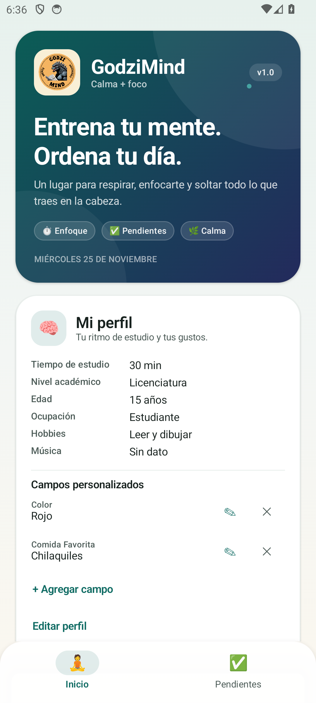
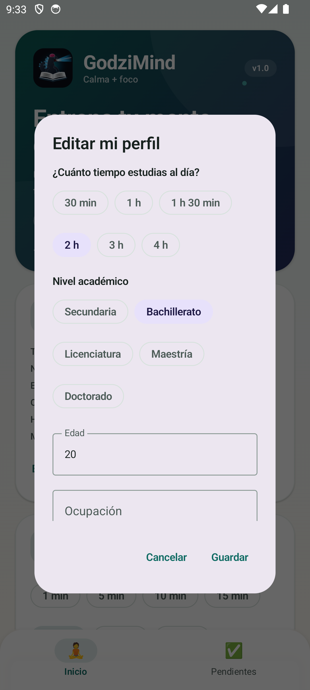
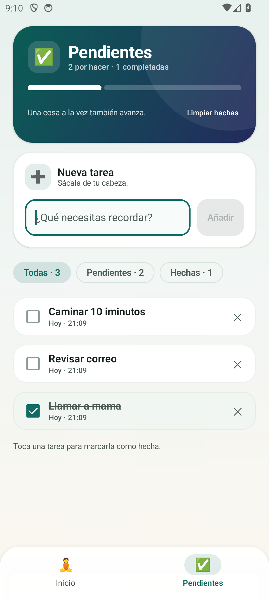

# GodziMind

App Android con **dos pantallas**, hecha con Kotlin, Jetpack Compose y **Material 3**.
La idea es simple: un lugar para bajar el ruido mental y ordenar el día.

Al abrir la app por primera vez se muestra un **perfil de estudio** (tiempo diario,
nivel académico, edad, ocupación, hobbies y tipo de música) que se guarda en Room.
En la card **Mi perfil** se puede editar y además agregar **campos personalizados**
(nombre + valor), que se guardan en la tabla `profile_fields` y se pueden actualizar
o eliminar.

Este proyecto implementa la práctica del PDF **“Conexión con SQLite usando la biblioteca
Room”**: Room + DAO + entidad + repositorio + mappers + Hilt + ViewModel con `StateFlow`
y patrón UDF. El ejemplo de `Producto` del tutorial se adaptó a las **tareas** de
GodziMind para no agregar una tercera pantalla.

## Las dos pantallas

### 1. Inicio

Todo el contenido vive en **cards**:

- **Cabecera de marca** con el propósito de la app.
- **Cronómetro de enfoque**: eliges entre 1 y 60 minutos con chips rápidos o con el
  deslizador. Tiene iniciar, pausar, reanudar y reiniciar. El tiempo sigue corriendo
  aunque cambies de pestaña, porque el estado vive en un `ViewModel`.
- **¿Qué hace GodziMind?**: explica la función de la app en tres puntos.
- **Píldora de mente**: microlectura obtenida de la API REST de Wikipedia en español,
  con contenido local de respaldo si no hay conexión.
- **Cómo se usa**, **beneficios** y **privacidad**, también en cards.

### 2. Pendientes

- Cabecera con progreso y contador de tareas.
- Alta de tareas con teclado.
- Filtros: Todas, Pendientes y Hechas.
- Cada tarea es una card con checkbox, fecha y borrado.
- Persistencia en **Room** (`godzimind.db`), no en `SharedPreferences`.

## Arquitectura Room + Hilt

```text
UI (Compose)
   │  eventos / StateFlow
   ▼
TasksViewModel  @HiltViewModel
   │  TaskRepository (interfaz de dominio)
   ▼
TaskRepositoryImpl  @Singleton
   │  TaskDao
   ▼
Room: AppDatabase ── TaskEntity (tabla tasks)
```

- **Entidad:** `TaskEntity` con `@Entity(tableName = "tasks")`, `@PrimaryKey(autoGenerate = true)`
  y validación del título.
- **Perfil:** `StudyProfileEntity` en la tabla `study_profiles`, con tiempo diario de
  estudio, nivel académico, edad, ocupación, hobbies y tipo de música.
- **Campos personalizados:** `ProfileFieldEntity` en la tabla `profile_fields`; cada
  fila es un campo nombre/valor que se puede agregar, editar o borrar. Si agregas un
  campo con un nombre que ya existe, se actualiza esa fila en lugar de duplicarla.
- **DAO:** `TaskDao`, `StudyProfileDao` y `ProfileFieldDao` con `@Insert`, `@Update`,
  `@Delete` y consultas `Flow`.
- **Base de datos:** `AppDatabase` versión 5, con migración 4 → 5 para conservar los
  datos anteriores.
- **Repositorios de dominio:** `TaskRepository`, `StudyProfileRepository` y
  `ProfileFieldRepository`.
- **Implementaciones:** `TaskRepositoryImpl`, `StudyProfileRepositoryImpl` y
  `ProfileFieldRepositoryImpl`.
- **Mappers:** `TaskEntity.toDomain()`, `Task.toEntity()`, `StudyProfileEntity.toDomain()`,
  `StudyProfile.toEntity()` y los de `ProfileField`.
- **Inyección de dependencias:** `DatabaseModule` y `RepositoryModule` con Hilt.
- **Application:** `GodziMindApplication` con `@HiltAndroidApp`.
- **Activity:** `MainActivity` con `@AndroidEntryPoint`.
- **ViewModels:** `TasksViewModel` y `StudyProfileViewModel` con `@HiltViewModel`,
  `StateFlow` y `SharingStarted.WhileSubscribed(5_000)`.
- **UI:** `collectAsStateWithLifecycle()`, `hiltViewModel()`, el diálogo
  `StudyProfileDialog` al iniciar y la card **Mi perfil** para editarlo.

## CRUD implementado

| Tabla | Insert | Select | Update | Delete |
| --- | --- | --- | --- | --- |
| `tasks` | `insertarTarea()` | `obtenerTareas()` + Flow | `actualizarTarea()` (toggle) | `eliminarTarea()` / `eliminarCompletadas()` |
| `study_profiles` | `guardarPerfil()` | `observarPerfil()` + Flow | `actualizarPerfil()` (Editar perfil) | `eliminarPerfil()` (Borrar perfil) |
| `profile_fields` | `insertarCampo()` | `observarCampos()` + Flow | `actualizarCampo()` | `eliminarCampo()` / `eliminarTodos()` |
| `focus_sessions` | `insertarSesion()` | `obtenerSesiones()` + Flow | `actualizarSesion()` | `eliminarSesion()` |

El cronómetro inserta automáticamente una sesión en `focus_sessions` al terminar.
En la app, las operaciones se prueban desde **Pendientes** (tareas) y desde **Inicio → Mi perfil** (perfil y campos personalizados).

## API elegida

**Wikipedia REST API en español** (`https://es.wikipedia.org/api/rest_v1/page/summary/{tema}`).
Encaja con GodziMind porque entrega microlecturas reales y en español sobre atención
plena, meditación, respiración, sueño, etc., sin API key. La app rota entre varios temas
y, si falla la red, muestra una píldora local con el mismo formato.

Permisos: `INTERNET` y `ACCESS_NETWORK_STATE`.

## Stack

- Kotlin 2.2.10, Jetpack Compose, Material 3
- AGP 9.2.1 / Gradle 9.4.1
- Room 2.8.5, KSP 2.3.4
- Hilt 2.59.2 + `hilt-navigation-compose` 1.3.0
- `compileSdk = 37`, `targetSdk = 36`, `minSdk = 26`
- Sin librerías de red externas: `HttpURLConnection` + `org.json`

## Cómo ejecutar

Abre la carpeta `GodziMind` en Android Studio y ejecuta la configuración `app`.

Por consola:

```bat
gradlew.bat assembleDebug
```

El APK queda en:

```text
app\build\outputs\apk\debug\app-debug.apk
```

Para las pruebas de utilidades:

```bat
gradlew.bat testDebugUnitTest
```

## Nota sobre dependencias

El proyecto se compiló sin conexión en este equipo. Por eso `app/build.gradle.kts`
fija Lifecycle 2.9.4 y material-ripple 1.10.4, que son las versiones completas en la
caché local. Si más adelante actualizas las dependencias con internet, puedes quitar
ese bloque `resolutionStrategy`.

## Estructura

```text
app/src/main/java/com/godzistudio/godzimind/
├── MainActivity.kt              @AndroidEntryPoint
├── GodziMindApplication.kt      @HiltAndroidApp
├── domain/
│   ├── model/Task.kt
│   └── repository/TaskRepository.kt
├── data/
│   ├── local/
│   │   ├── AppDatabase.kt
│   │   ├── Migrations.kt
│   │   ├── dao/TaskDao.kt
│   │   ├── dao/StudyProfileDao.kt
│   │   ├── dao/ProfileFieldDao.kt
│   │   ├── entity/TaskEntity.kt
│   │   ├── entity/StudyProfileEntity.kt
│   │   └── entity/ProfileFieldEntity.kt
│   ├── mapper/TaskMapper.kt
│   ├── mapper/StudyProfileMapper.kt
│   ├── mapper/ProfileFieldMapper.kt
│   ├── repository/TaskRepositoryImpl.kt
│   ├── repository/StudyProfileRepositoryImpl.kt
│   ├── repository/ProfileFieldRepositoryImpl.kt
│   ├── di/DatabaseModule.kt
│   ├── di/RepositoryModule.kt
│   ├── MindPillRepository.kt
│   └── NetworkStatus.kt
├── ui/
│   ├── GodziMindApp.kt          navegación inferior de 2 destinos
│   ├── components/              cards, badges, pills y fondo
│   ├── screens/                 HomeScreen, TasksScreen, cronómetro, píldora
│   └── theme/                   colores, tipografía y MaterialTheme
└── util/                        formatos de tiempo y fecha
```

## Capturas

| Inicio | Perfil de estudio | Pendientes |
| --- | --- | --- |
|  |  |  |

> El logo de GodziMind está en `app/src/main/res/drawable/godzi_logo.png` y se usa
> tanto en la cabecera de Inicio como en el icono de la app.

## Documentacion Unidad 3

- [Criterio 1 - Lista de verificacion](docs/GodziMind_Unidad3_Criterio1.pdf)

